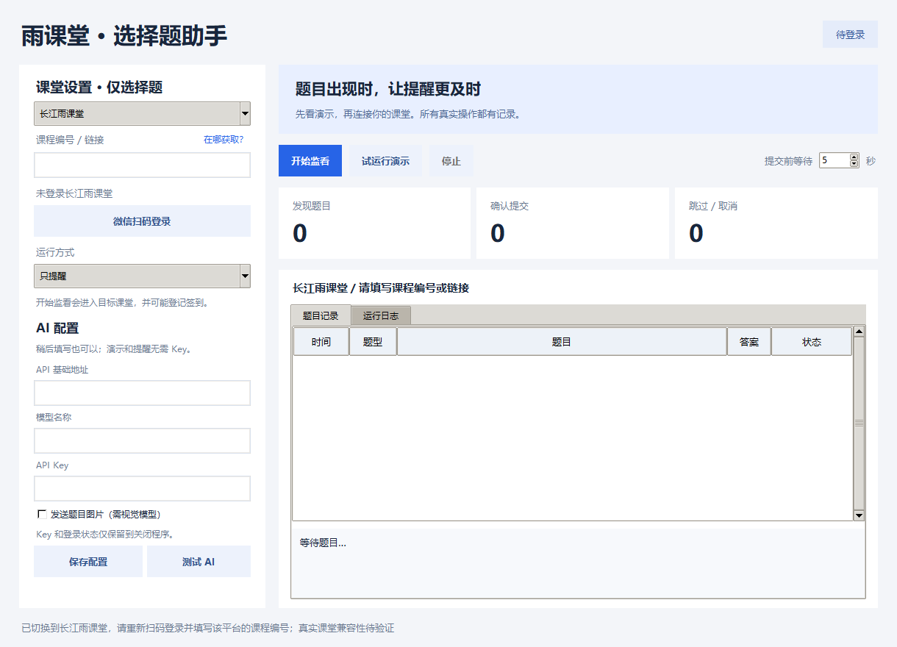

# RainChoice · 雨课堂选择题助手

Windows 桌面工具，用于提醒雨课堂新选择题、生成 AI 建议，或自动提交单选与多选答案。非雨课堂官方软件。

## 界面预览



以下为此前版本的运行截图：


## 功能

- 微信扫码登录，按课程编号监看课堂新题。
- 可切换普通雨课堂与长江雨课堂；切换后重新登录，各平台的登录状态和答题记录隔离。
- 课程编号框可填写数字或粘贴完整课程链接，旁边提供“在哪获取？”帮助。
- 只提醒、AI 建议、AI 自动提交三种模式，默认只提醒。
- 支持 Chat Completions 兼容服务；图片题需要支持图片输入的模型。
- 提交前默认等待 5 秒，可调为 0–30 秒，显示倒计时。
- 等待期间停止监看或收到题目关闭消息会取消提交。
- 答案校验、题目去重、明确的提交结果记录；无有效答案时跳过。
- 内置离线演示，无需账号或 API Key。

## 使用

Windows 可执行程序见 [Releases](https://github.com/jbyzh/RainChoice/releases)。解压到可写目录，运行 `RainChoice.exe`，点击“试运行演示”。

从源码运行（Python 3.12）：

```powershell
python -m venv .venv
.\.venv\Scripts\python.exe -m pip install -r requirements.txt
.\.venv\Scripts\python.exe app.py
```

真实使用时先选择平台，再填写自己的课程编号、扫码登录，并按需配置 AI。操作步骤见 [使用说明](使用说明.md)，测试与打包见 [BUILD.md](BUILD.md)。

## 平台选择与课程编号

1. 在软件“课堂设置”下拉框中选择平台，并在浏览器打开同一平台：

   | 平台 | 官方网页版 |
   | --- | --- |
   | 普通雨课堂 | [www.yuketang.cn](https://www.yuketang.cn/web) |
   | 长江雨课堂 | [changjiang.yuketang.cn](https://changjiang.yuketang.cn/web/) |

2. 在网页版登录后，打开“我的课程”里的具体课程，查看浏览器地址栏。`classroom_id=` 后的数字，或 `/studentLog/` 后的数字，就是本工具需要的课程编号。
3. 例如 `https://changjiang.yuketang.cn/v2/web/studentLog/12345678?classroom_id=12345678` 对应编号 **12345678**（仅为示例）。可输入编号，也可将完整链接粘贴到“课程编号 / 链接”框。

课程名称、课堂暗号、`university_id`、`platform_id` 和 `lessonId` 都不是这里的课程编号。若地址只指向首页或课程列表，先点击具体课程。链接与所选平台不一致时，程序会提示检查。

切换平台前先停止当前任务并等待结束；切换会清空登录状态和课程输入，并回到“只提醒”模式。旧配置默认使用普通雨课堂，原有历史记录继续保留。

**长江雨课堂验证范围：** 已验证公开扫码通道返回二维码，并通过模拟登录、课堂消息及提交测试；尚未完成长江平台的真实账号登录和真实课堂出题、提交验证。平台切换不代表所有学校的课堂接口都已确认兼容。

## 数据与限制

API Key 和登录状态仅保留在内存中。普通配置（含所选平台）写入本地 `settings.json`；普通雨课堂记录写入 `data/history.jsonl`，长江雨课堂记录写入 `data/changjiang/history.jsonl`。这些文件已加入 `.gitignore`。

开启 AI 后，题目、选项和可选的课件图片地址会发送给用户配置的模型服务。开始监看会进入目标课堂，可能登记签到。请在课程允许 AI 辅助且自己有权访问的课堂使用。

当前发布经过离线演示及模拟接口测试，尚未完成真实 AI 与课堂提交的端到端验证。AI 可能答错，平台接口、网络或答题时间限制可能造成漏题；不能保证每道题都成功提交。

## 来源与许可

课堂连接逻辑改编自 [thuhollow2/yuketang](https://github.com/thuhollow2/yuketang)，沿用 MIT 许可并保留原作者声明。详细来源与验证范围见 [SOURCE.md](SOURCE.md)、[LICENSE](LICENSE) 和 [THIRD_PARTY_LICENSE.txt](THIRD_PARTY_LICENSE.txt)。
