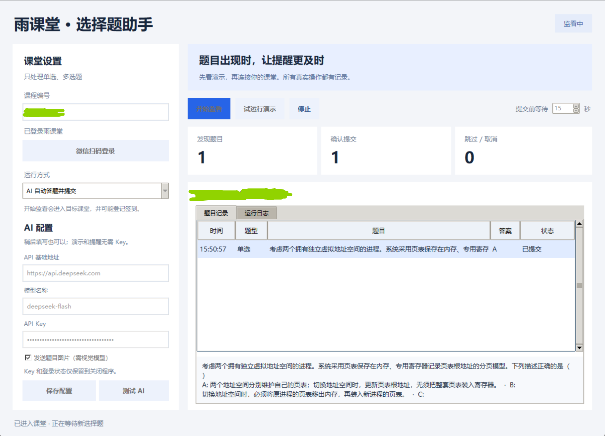

# RainChoice · 雨课堂选择题助手

Windows 桌面工具，用于提醒雨课堂新选择题、生成 AI 建议，或自动提交单选与多选答案。非雨课堂官方软件。

## 界面预览



## 功能

- 微信扫码登录，按课程编号监看课堂新题。
- 只提醒、AI 建议、AI 自动提交三种模式，默认只提醒。
- 支持 Chat Completions 兼容服务；图片题需要支持图片输入的模型。
- 提交前默认等待 5 秒，可调为 0–30 秒，显示倒计时。
- 等待期间停止监看或收到题目关闭消息会取消提交。
- 答案校验、题目去重、明确的提交结果记录；无有效答案时跳过。
- 内置离线演示，无需账号或 API Key。

## 使用

Windows 可执行程序见 [Releases](https://github.com/jbyzh/RainChoice/releases)。解压到可写目录，运行 `RainChoice.exe`，点击“试运行演示”。

从源码运行（Python 3.12）：

```powershell
python -m venv .venv
.\.venv\Scripts\python.exe -m pip install -r requirements.txt
.\.venv\Scripts\python.exe app.py
```

真实使用时填写自己的课程编号、扫码登录，并按需配置 AI。操作步骤见 [使用说明](使用说明.md)，测试与打包见 [BUILD.md](BUILD.md)。

## 数据与限制

API Key 和登录状态仅保留在内存中。普通配置写入本地 `settings.json`，真实题目与处理记录写入 `data/history.jsonl`，这些文件已加入 `.gitignore`。

开启 AI 后，题目、选项和可选的课件图片地址会发送给用户配置的模型服务。开始监看会进入目标课堂，可能登记签到。请在课程允许 AI 辅助且自己有权访问的课堂使用。

当前发布经过离线演示及模拟接口测试，尚未完成真实 AI 与课堂提交的端到端验证。AI 可能答错，平台接口、网络或答题时间限制可能造成漏题；不能保证每道题都成功提交。

## 来源与许可

课堂连接逻辑改编自 [thuhollow2/yuketang](https://github.com/thuhollow2/yuketang)，沿用 MIT 许可并保留原作者声明。详细来源与验证范围见 [SOURCE.md](SOURCE.md)、[LICENSE](LICENSE) 和 [THIRD_PARTY_LICENSE.txt](THIRD_PARTY_LICENSE.txt)。
